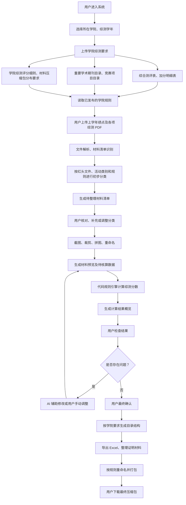
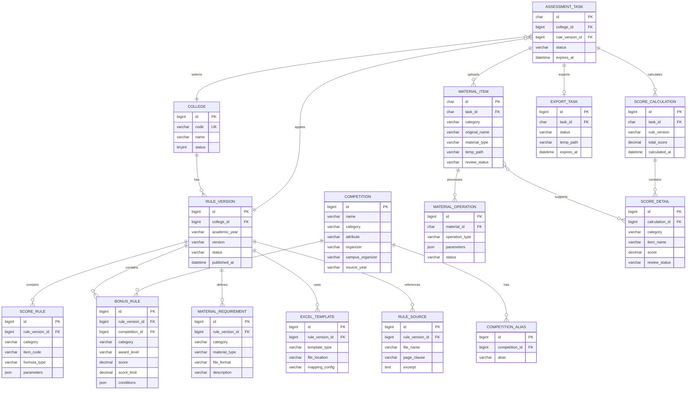

# Integration——一个减轻综测整理负担的辅助系统

> 目前针对计算机学院进行一个实验性产品产出，后续会针对不同的学院进行优化
## 1️⃣主要流程图
> 因为每年的要求不同，上传的综测要求会有差错，针对这两年的综测提交，我归纳成如下的过程
> 
**注意**：还存在个问题，PDF文件关于智育的活动除了参加学科比赛，其他无关的都不算，这个后续需要解决（人工）

## 2️⃣领域模型

